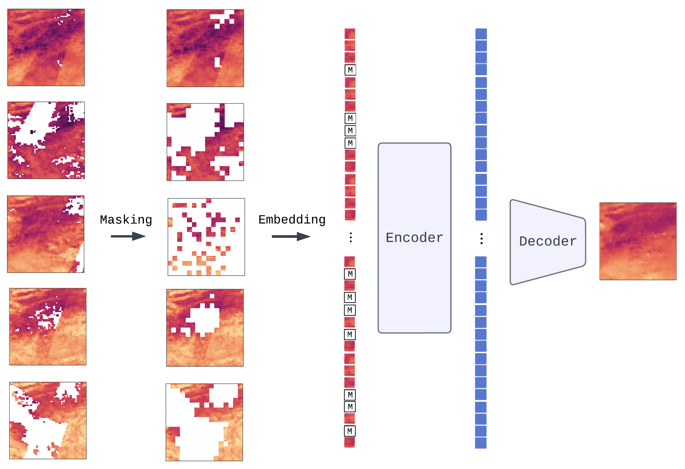

# From random masks to real gaps

Code for the paper *From random masks to real gaps: tailoring masked image modelling for Earth observation gap-filling*.

Satellite observations are often incomplete because of cloud cover or gaps between satellite swaths. Masked image modelling (MIM) pre-trains models by reconstructing hidden parts of an image. Gap-filling asks for the same thing, so MIM is a natural fit for it. This repository studies how much adaptation a MIM-pre-trained model needs to fill realistic gaps.

We train a compact spatiotemporal model with a Video Vision Transformer (ViViT) backbone on two products with very different gap patterns.

- **Envisat land surface temperature (LST)** from the Earth System Data Cube (ESDC). Gaps mostly stem from satellite swaths.
- **Sentinel-2 multispectral imagery**. Gaps mostly stem from clouds.

The model is pre-trained directly on gap-contaminated time series. Gaps are never interpolated or imputed. We then compare four levels of adaptation on held-out gap-filling datasets with realistic synthetic gaps.

## Method



Each sample is a series of five consecutive frames. The model reconstructs the middle frame.

- **Two-step masking.** Every patch that contains a missing pixel is masked in all five frames. On top of that, the middle frame is randomly masked to a ratio drawn from [0.7, 1.0].
- **Mask tokens stay in the sequence.** Masked patches are replaced by a learned mask token, following MaskFeat. The sequence length is therefore the same for every sample, no matter how many patches are gaps.
- **Encoder.** A ViViT encoder with factorized space-time attention, sized like ViT-Ti (embedding dimension 192, depth 12, 3 heads, about 11M parameters). Each frame is split into 4 × 4 pixel patches.
- **Decoder.** A single cross-attention layer combines the five frames for each middle-frame token. A small MLP head maps the result back to pixels.
- **Loss.** Mean absolute error over masked patches only, and only over pixels that were actually observed.

## Results

Mean absolute error (MAE) over synthetic gap pixels of the middle frame, on each product's held-out gap-filling evaluation set.

| Adaptation level | ESDC LST MAE (norm.) | ESDC LST MAE (K) | Sentinel-2 MAE (norm.) |
|---|---|---|---|
| Zero-shot | 0.0211 | 3.80 | 0.0203 |
| Fine-tuning | 0.0183 | 3.29 | **0.0193** |
| Block masking | 0.0180 | 3.24 | 0.0214 |
| From scratch | **0.0173** | **3.11** | 0.0210 |
| Kriging baseline | 0.0195 | 3.51 | n/a |
| Linear interpolation baseline | 0.0213 | 3.84 | n/a |

Fine-tuning uses 100 samples for ESDC and 400 samples for Sentinel-2. These counts were chosen with the fine-tuning sample-count ablations in `*/experiments/exp02_finetuning/sample_ablation/`. The full result tables, including training and validation losses, are in [`esdc/experiments/RESULTS.md`](esdc/experiments/RESULTS.md), [`sentinel/experiments/RESULTS.md`](sentinel/experiments/RESULTS.md) and the `results/` folders of the ablations.

## Repository structure

```
├── model_gap_aware/        # Shared model and data loading
│   ├── vivit.py            # ViViT encoder with gap, random and block masking
│   ├── maskfeat.py         # MaskFeatGapFiller (Lightning module) and decoder
│   ├── lmdb_training.py    # LMDB datasets and data modules, build_model()
│   └── checkpoint_metrics.py
├── esdc/                   # Envisat LST from the Earth System Data Cube
│   ├── src/                # Dataset creation, training, evaluation, analysis, visualization
│   ├── scripts/            # Pipeline scripts (local/ and slurm/)
│   └── experiments/        # Experiment configs, scripts and results
├── sentinel/               # Sentinel-2 multispectral imagery
│   ├── src/                # Google Earth Engine download, LMDB creation, training, evaluation
│   ├── scripts/            # Pipeline scripts (local/ and slurm/)
│   ├── experiments/        # Experiment configs, scripts and results
│   └── data/               # SSL4EO-S12 location files
├── environment.yml
└── .env.example            # Template for the environment variables
```

Both modules write LMDBs with the same structure (float32 tensors of shape `(T, C, H, W)`). This lets `model_gap_aware/` train on either dataset without code changes.

## Installation

```bash
git clone https://github.com/CharlyZimmer/from-random-masks-to-real-gaps.git
cd from-random-masks-to-real-gaps
conda env create -f environment.yml
conda activate gap-aware
```

The environment includes [patchfill](https://github.com/CharlyZimmer/patchfill), which builds the ESDC datasets. On a machine with a GPU, conda-forge installs a CUDA build of PyTorch.

### Configuration

Data locations are set with environment variables. [`.env.example`](.env.example) lists all of them with a short description. Copy the ones you need into your `~/.bashrc` (or a file you `source`). Unset path variables fall back to `esdc/data/` and `sentinel/data/` inside the repository.

Downloading Sentinel-2 data needs a Google Cloud project with Earth Engine enabled. Set `EE_PROJECT` and run `earthengine authenticate` once. The Slurm download scripts use a service account instead and also need `EE_SERVICE_ACCOUNT` and `EE_KEY_FILE`.

## Running the pipeline

All scripts are run from the repository root. Each step has two versions.

- `scripts/local/` runs on a CPU with small data subsets and tiny models. Use these to check that the pipeline works.
- `scripts/slurm/` runs the full-scale jobs on a Slurm cluster (`sbatch <script>`). The `#SBATCH` partition and GPU settings are specific to our cluster and need to be adapted.

### ESDC land surface temperature

The ESDC is read directly from its public Zarr store, so there is no separate download step.

```bash
# Pre-training dataset (2002-2010) and LMDB
./esdc/scripts/local/create_pretraining_dataset.sh
./esdc/scripts/local/create_lmdb.sh

# Gap-filling evaluation dataset (2011, synthetic gaps)
./esdc/scripts/local/create_gapfilling_dataset.sh

# Gap-filling training dataset and LMDB (for fine-tuning and from-scratch training)
./esdc/scripts/local/create_gapfilling_training_dataset.sh
./esdc/scripts/local/create_gapfilling_training_lmdb.sh
```

`compute_value_ranges.sh` precomputes the normalization ranges of the data cube variables. The dataset scripts compute them on demand if they are missing. Once a model is trained, `fill_datacube.sh` uses it to fill the gaps of a whole data cube time span.

### Sentinel-2

```bash
# Pre-training data at the SSL4EO-S12 locations, then LMDB
./sentinel/scripts/local/download_data.sh
./sentinel/scripts/local/create_lmdb.sh

# Gap-filling evaluation dataset (new locations, spatially disjoint from pre-training)
./sentinel/scripts/local/download_gap_filling_data.sh

# Gap-filling training dataset (synthetic gap masks for the pre-training locations)
./sentinel/scripts/local/download_gap_filling_training_data.sh
./sentinel/scripts/local/create_gapfilling_training_lmdb.sh
```

The gap-filling training set does not store a second copy of the imagery. It only stores a gap mask per location. At training time, these masks are joined with the pre-training LMDB by location index.

## Reproducing the experiments

Each experiment lives in its own folder under `esdc/experiments/` and `sentinel/experiments/`.

| Experiment | Adaptation level |
|---|---|
| `exp01_zero_shot` | Pre-training with random masking, evaluated without further training |
| `exp02_finetuning` | Zero-shot checkpoint fine-tuned on a small gap-filling training set |
| `exp03_structured_masking` | Pre-training with a single contiguous block mask (BEiT-style) instead of random masking |
| `exp04_scratch_gapfilling` | Trained from scratch on the gap-filling training set |
| `interpolation_baseline` | Ordinary Kriging, purely spatial |
| `linear_interpolation_baseline` | Linear interpolation, purely spatial |

Nested ablations cover the fine-tuning sample count (`exp02_finetuning/sample_ablation/`), the maximum gap ratio of pre-training samples (`exp01_zero_shot/max_gap_ablation/`) and, for ESDC, the model size (`exp01_zero_shot/model_size_ablation/`).

Each experiment folder holds a `config.yaml` with all dataset, model and training parameters, `scripts/{local,slurm}/train.sh` and `evaluate.sh`, and a `results/` folder with `metrics.json` and `run_info.json`. For example:

```bash
# Quick local check
./esdc/experiments/exp01_zero_shot/scripts/local/train.sh
./esdc/experiments/exp01_zero_shot/scripts/local/evaluate.sh

# Full run
sbatch esdc/experiments/exp01_zero_shot/scripts/slurm/train.sh
sbatch esdc/experiments/exp01_zero_shot/scripts/slurm/evaluate.sh

# Rebuild the results table
python esdc/experiments/scripts/collect_results.py
```

The module READMEs ([ESDC](esdc/experiments/README.md), [Sentinel-2](sentinel/experiments/README.md)) describe the experiment layout in more detail.

## Data

The source products are publicly available.

- Earth System Data Cube v2.1.1 ([Mahecha et al., 2020](https://doi.org/10.5194/esd-11-201-2020)), including Envisat AATSR land surface temperature from the GlobTemperature project and ERA5 2 m air temperature.
- Sentinel-2 Level-2A surface reflectance, accessed through Google Earth Engine.
- Sample locations from [SSL4EO-S12](https://github.com/zhu-xlab/SSL4EO-S12) (`sentinel/data/ssl4eo-s12_center_coords.csv`).

The pre-training and gap-filling datasets used in the paper will be linked here once they are published.

## Citation

The citation will be added once the paper is published. Authors: Charly Zimmer, Josefine Umlauft, David Montero, Guido Kraemer and Miguel D. Mahecha.

## License

This project is licensed under the Apache License 2.0. See [LICENSE](LICENSE).
