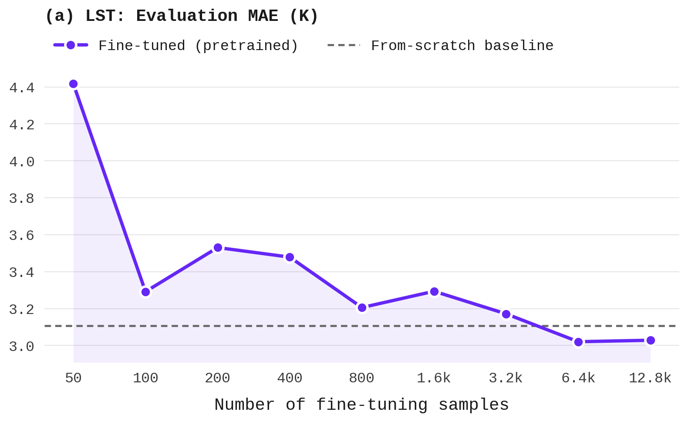

# exp02_finetuning — Sample-Count Ablation Results

Sub-experiment of `exp02_finetuning` (see `../README.md`). Same pretrained checkpoint (`exp01_zero_shot`), same effective peak LR (4e-5) and LR schedule shape, same model config (192/12/3, patch_size=4) as `exp02_finetuning` — only the number of fine-tuning samples drawn (seeded, seed=42) from `$ESDC_GAP_FILLING_TRAINING_DIR/lmdb/dataset_test.lmdb` varies, and training runs for 20 epochs, the same as exp02. The 3 smallest variants (n0050/n0100/n0200) train on a single GPU instead of 4-way DDP (4-way DDP leaves too few, or for n0050 zero, steps/epoch at this scale) — `base_lr` is rescaled accordingly (`4e-5` vs `1e-5` for n0400-n12800) so the actual peak LR stays identical across all 9 variants; see the individual `configs/n*.yaml` files.

"N samples" below is the number of *fine-tuning* samples used, not the eval-set size — every row is evaluated on the same canonical, fixed eval set (`$ESDC_GAP_FILLING_DIR/dataset.h5`, `N eval samples` column) used by every other experiment in this repo. MAE is computed over synthetic gap pixels in the middle frame only.

| ID | N samples | Status | Train loss | Val loss | MAE (norm) | MAE (K) | N eval samples | Eval date |
|----|-----------|--------|-----------|---------|-----------|---------|-----------------|-----------|
| exp02_finetuning_n0050 | 50 | done | 0.0191 | 0.0134 | 0.0245 | 4.42 | 4569 | 2026-09-14 |
| exp02_finetuning_n0100 | 100 | done | 0.0145 | 0.0102 | 0.0183 | 3.29 | 4569 | 2026-09-14 |
| exp02_finetuning_n0200 | 200 | done | 0.0146 | 0.0141 | 0.0196 | 3.53 | 4569 | 2026-09-14 |
| exp02_finetuning_n0400 | 400 | done | 0.0169 | 0.0167 | 0.0193 | 3.48 | 4569 | 2026-09-14 |
| exp02_finetuning_n0800 | 800 | done | 0.0133 | 0.0142 | 0.0178 | 3.21 | 4569 | 2026-09-14 |
| exp02_finetuning_n1600 | 1600 | done | 0.0156 | 0.0133 | 0.0183 | 3.29 | 4569 | 2026-09-14 |
| exp02_finetuning_n3200 | 3200 | done | 0.0117 | 0.0135 | 0.0176 | 3.17 | 4569 | 2026-09-14 |
| exp02_finetuning_n6400 | 6400 | done | 0.0135 | 0.0132 | 0.0168 | 3.02 | 4569 | 2026-09-14 |
| exp02_finetuning_n12800 | 12800 | done | 0.0134 | 0.0141 | 0.0168 | 3.03 | 4569 | 2026-09-14 |
| exp04_scratch_gapfilling (reference) | n/a (from scratch) | done | 0.0124 | 0.0142 | 0.0173 | 3.11 | 4569 | 2026-08-26 |

_Regenerate with: `python esdc/experiments/exp02_finetuning/sample_ablation/scripts/collect_results.py` (writes this file directly). Regenerate the plot with `python esdc/experiments/exp02_finetuning/sample_ablation/scripts/plot_results.py`._
