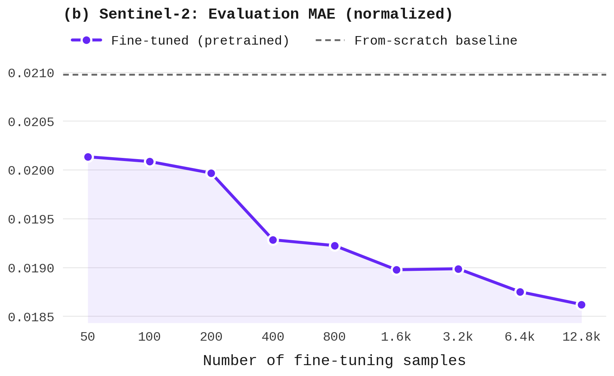

# exp02_finetuning — Sample-Count Ablation Results

Sub-experiment of `exp02_finetuning` (see `../README.md`). Same pretrained checkpoint (`exp01_zero_shot`), same effective peak LR (4e-5) and LR schedule shape, same model config (192/12/3, patch_size=4) as `exp02_finetuning` — only the number of fine-tuning samples drawn (seeded, seed=42) from `$S2_LMDB_PATH` joined with `$S2_GAP_FILLING_TRAINING_DIR/lmdb/gap_masks.lmdb` varies, and training runs for 20 epochs, the same as exp02. The 3 smallest variants (n0050/n0100/n0200) train on a single GPU instead of 4-way DDP (4-way DDP leaves too few steps/epoch per replica at this scale with batch_size=8) — `base_lr` is rescaled accordingly (`4e-5` vs `1e-5` for n0400-n12800) so the actual peak LR stays identical across all 9 variants; see the individual `configs/n*.yaml` files.

"N samples" below is the number of *fine-tuning* samples used, not the eval-set size — every row is evaluated on the same canonical, fixed eval set (`$S2_DATA_DIR/gap_filling`, `N eval samples` column) used by every other experiment in this repo. MAE is computed over synthetic gap pixels in the middle frame, averaged across all 10 bands. Sentinel has no single physical unit like ESDC's Kelvin, so only normalized ([0,1] reflectance) MAE is shown.

| ID | N samples | Status | Train loss | Val loss | MAE (norm) | N eval samples | Eval date |
|----|-----------|--------|-----------|---------|-----------|-----------------|-----------|
| exp02_finetuning_n0050 | 50 | done | 0.0137 | 0.0061 | 0.0201 | 10624 | 2026-08-26 |
| exp02_finetuning_n0100 | 100 | done | 0.0164 | 0.0211 | 0.0201 | 10624 | 2026-08-26 |
| exp02_finetuning_n0200 | 200 | done | 0.0147 | 0.0257 | 0.0200 | 10624 | 2026-08-26 |
| exp02_finetuning_n0400 | 400 | done | 0.0128 | 0.0153 | 0.0193 | 10624 | 2026-08-26 |
| exp02_finetuning_n0800 | 800 | done | 0.0142 | 0.0158 | 0.0192 | 10624 | 2026-08-26 |
| exp02_finetuning_n1600 | 1600 | done | 0.0143 | 0.0139 | 0.0190 | 10624 | 2026-08-26 |
| exp02_finetuning_n3200 | 3200 | done | 0.0138 | 0.0150 | 0.0190 | 10624 | 2026-08-26 |
| exp02_finetuning_n6400 | 6400 | done | 0.0136 | 0.0156 | 0.0188 | 10624 | 2026-08-26 |
| exp02_finetuning_n12800 | 12800 | done | 0.0149 | 0.0161 | 0.0186 | 10624 | 2026-08-26 |
| exp04_scratch_gapfilling (reference) | n/a (from scratch) | done | 0.0134 | 0.0147 | 0.0210 | 10624 | 2026-09-07 |

_Regenerate with: `python sentinel/experiments/exp02_finetuning/sample_ablation/scripts/collect_results.py` (writes this file directly). Regenerate the plot with `python sentinel/experiments/exp02_finetuning/sample_ablation/scripts/plot_results.py`._
